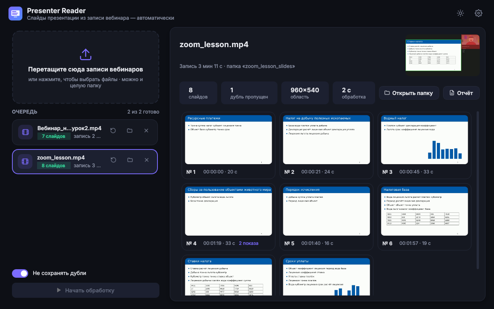
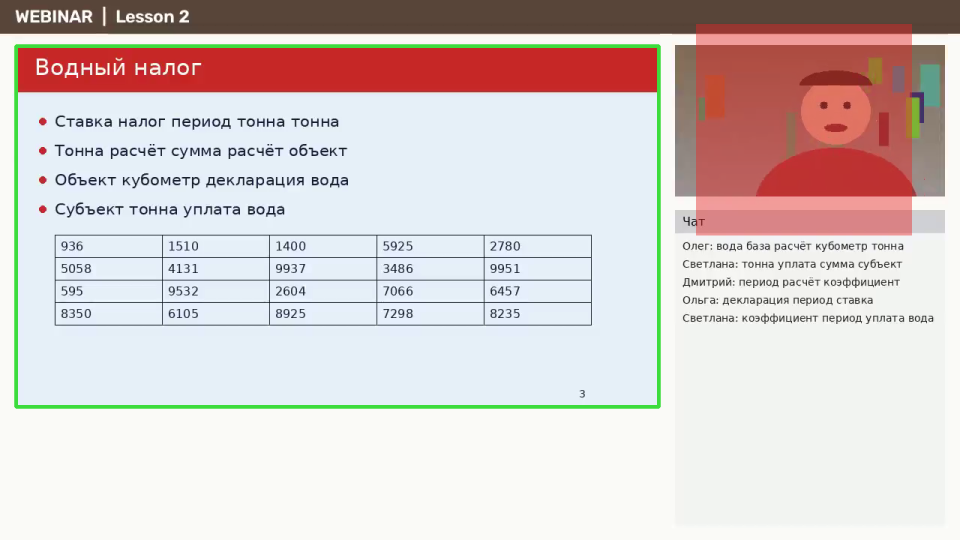

# Presenter Reader

Программа на Python, которая берёт **запись вебинара**, сама находит в кадре **прямоугольную область
презентации** (не путая её с видео ведущего, чатом и интерфейсом площадки) и сохраняет
**по одному PNG-скриншоту на каждый показанный слайд**. Постановка задачи — в [TASK.md](TASK.md).



- Работает с записями Zoom, Teams, МТС Линк / Webinar.ru, YouTube, OBS и т. п., с любым
  расположением камеры: сбоку, в углу поверх слайда, полосой внизу, на весь экран между слайдами.
- Трёхчасовая запись 1080p обрабатывается за 2–3 минуты на обычном 4-ядерном компьютере.
- Слайдом считается любая картинка, которая остановилась в области презентации, сколько бы
  она ни простояла. Кадры перехода, курсор и шум сжатия отсеиваются.
- Пошаговая анимация (пункты появляются по одному) сохраняется одним итоговым кадром.
- Повторно показанный слайд сохраняется ещё раз, а в имени файла указано, на какой слайд он
  похож и на сколько процентов. Переключатель «Не сохранять дубли» выключает сохранение почти
  неотличимых повторов: в отчёте у исходного слайда просто появится ещё одно время показа.

---

## Установка

Нужен Python 3.9 или новее. FFmpeg ставить отдельно не нужно: он входит в пакет `av`.

```bash
pip install -r requirements.txt        # numpy, opencv-python-headless, av, PySide6-Essentials
# или как пакет — появятся команды presenter-reader и presenter-reader-gui:
pip install ".[gui]"
```

Для работы без графического интерфейса достаточно `pip install .`, без PySide6.

Пошаговая инструкция для ИИ-агентов (скачать, установить, проверить, запустить, разобрать
`report.json`) — в [AGENTS.md](AGENTS.md). История изменений и разборы ошибок — в
[CHANGELOG.md](CHANGELOG.md).

### Как поручить проект ИИ-агенту

Скопируйте агенту (Claude Code, Codex, Cursor и т. п.) такой текст, подставив путь к видео:

> Скачай проект https://github.com/metalinjector/presenter-reader (ветка `main`, репозиторий
> публичный) и выполни инструкцию из `AGENTS.md` в его корне: установи зависимости, пройди
> самопроверку (шаг 3) и обработай видео `<путь к видео>` (шаг 4). Итог разбирай по
> `report.json` в папке результата; проверь по `layout.png`, что зелёная рамка обводит слайд,
> и если нет — повтори с `--roi`. Если нужны только уникальные слайды, добавь
> `--skip-duplicates`. Ответь: сколько слайдов найдено, где лежат скриншоты, были ли ошибки.

## Графический интерфейс

```bash
python -m presenter_reader        # без аргументов открывается окно
presenter-reader-gui              # то же после pip install
```

В Windows можно дважды щёлкнуть по `run_gui.pyw`.

1. Перетащите в окно один или несколько видеофайлов, можно и целую папку. Или нажмите на
   область «Перетащите сюда…» и выберите файлы.
2. Обработка начнётся сама; видео обрабатываются по очереди. У каждого видна стадия, процент
   и оставшееся время, обработку можно остановить.
3. Справа появится галерея найденных слайдов: номер, время показа, пометка «повтор №N · X %».
   Двойной щелчок открывает слайд. В правом верхнем углу — кадр с найденной областью,
   обведённой зелёной рамкой; по нему видно, правильно ли программа поняла раскладку.
4. Кнопки «Открыть папку» и «Отчёт» (HTML-страница с тайм-кодами).

Над кнопкой запуска — переключатель **«Не сохранять дубли»**. Если ведущий вернулся к слайду и
он почти не отличается от уже сохранённого (сходство от 95 %), скриншот не делается ещё раз, а
под исходным слайдом в галерее появляется «2 показа». Повторы с заметными отличиями
сохраняются с пометкой, как обычно. Переключатель действует на следующие обработки; уже готовое
видео можно обработать заново кнопкой ↻ на его карточке в очереди.

В настройках (шестерёнка) задаются: куда сохранять, чувствительность, минимальное время
неподвижной картинки, порог сходства для пометки повтора, склейка анимации, тщательный
режим, автозапуск. Есть светлая и тёмная темы.

## Командная строка

```bash
python -m presenter_reader webinar.mp4                    # результат в webinar_slides/ рядом с видео
python -m presenter_reader *.mp4 -o D:/slides              # несколько файлов, у каждого своя подпапка
python -m presenter_reader webinar.mp4 --start 10:00 --end 1:30:00
python -m presenter_reader webinar.mp4 --roi 0,90,960,540 # область вручную: x,y,ширина,высота
```

| Параметр | По умолчанию | Смысл |
|---|---|---|
| `-o, --out` | `<видео>_slides` | папка для результатов |
| `--min-duration С` | 1 | сколько секунд картинка должна стоять неподвижно; меньше — это кадр перехода |
| `--sensitivity X` | 1 | 2 — вдвое чувствительнее к мелким правкам, 0.5 — грубее |
| `--similar %` | 80 | с какого сходства помечать повтор |
| `--skip-duplicates` | — | не сохранять дубли: почти неотличимый повтор не сохраняется, его время показа добавляется к исходному слайду |
| `--duplicate-threshold %` | 95 | с какого сходства повтор считается дублем |
| `--no-merge-builds` | — | не склеивать пошаговую анимацию: каждый шаг — отдельный скриншот |
| `--mode` | auto | `auto` — быстрый проход по опорным кадрам; `sequential` — читать все кадры подряд |
| `--roi X,Y,W,H` | — | задать область презентации вручную |
| `--start`, `--end` | — | обработать только часть записи (секунды или `чч:мм:сс`) |

## Что получается на выходе

```
webinar_slides/
├── slide_001_00-00-00.png
├── slide_002_00-03-12.png
├── slide_003_00-11-40.png
├── slide_004_00-25-05_repeat-of-002_sim-98pct.png   ← повтор слайда 2, сходство 98 %
├── …
├── layout.png      кадр с найденной областью (зелёная рамка) и «живыми» зонами (красные)
├── index.html      галерея с тайм-кодами
├── slides.csv      таблица: номер, файл, начало, длительность, число показов, повтор, сходство
└── report.json     то же + все интервалы показа каждого слайда, параметры, раскладка
```

С `--skip-duplicates` (или переключателем в окне) файлов с `_repeat-of-…` почти неотличимых
повторов не будет. У исходного слайда в `report.json` увеличится `appearances`, в `shows` появится
время повторного показа, а в сводке — `duplicates_skipped`.

Скриншоты обрезаны по найденному прямоугольнику, то есть по самой большой области показа
презентации.



---

## Алгоритм

Общая схема — три прохода, из которых только первые два трогают видео, и оба быстрые:

```
 видео ──► 1. ОБЗОР ─────────────► прямоугольник презентации + карта «живых» зон
             опорные кадры                  │
             + «вспышки» (+0,6 с)           ▼
         ──► 2. ПОИСК СМЕН ──────────► «прогоны» неподвижной картинки + кадры для скриншотов
             опорные кадры; где между
             ними что-то поменялось —
             подробно, шаг 0,25 с
                                            ▼
             3. СБОРКА ──────────────► слайды: без переходов, с итогом анимации,
                                         с пометками повторов → PNG и отчёты
```

### 0. Почему это быстро

Видео сжато так, что полноценный (опорный, I-) кадр записан примерно раз в 1–10 секунд, а
между ними хранятся только изменения. Чтобы получить любой промежуточный кадр, декодер
обязан распаковать всю цепочку от опорного кадра. Поэтому подход «декодировать всё и смотреть
каждый N-й кадр» упирается в скорость декодера.

Программа декодирует **только опорные кадры**: остальные пакеты читаются с диска, но в
декодер не попадают. Это в 15–30 раз дешевле. Слайд держится минутами, поэтому опорных кадров
хватает, чтобы заметить, *что* картинка сменилась. Где между двумя соседними опорными кадрами
что-то поменялось, программа перематывает к первому из них и декодирует только этот отрезок
целиком, с шагом анализа 0,25 с. Так находятся точный момент смены и короткие слайды. Смен за
вебинар десятки, значит, подробно разбираются считанные минуты видео из нескольких часов.

Если опорные кадры в файле редки (реже раза в 20 с) или PyAV недоступен, программа
переключается в последовательный режим: декодирует всё подряд и анализирует 4 кадра в секунду.
Результат тот же, только медленнее.

Анализ идёт на уменьшенной копии: яркость берётся прямо из плоскости Y видеокадра, без
пересчёта цвета, и уменьшается каскадом через половинки. Цветной кадр полного размера
декодируется, только когда нужен для скриншота.

### 1. Обзор: где презентация, а где «живое»

Каждая выборка уменьшается до 480 точек по ширине и делится на блоки 12×12 пикселей.
Используются два вида пар кадров:

- **долгие пары** — соседние опорные кадры, разнесённые на секунды. По ним видно, *что* менялось
  за это время: смены слайдов, сообщения чата, движения камеры;
- **короткие пары** — опорный кадр и «вспышка» через 0,6 с, декодированная сразу за ним.
  Около 600 таких пар на всё видео. За полсекунды слайд почти никогда не меняется, а камера
  с ведущим меняется почти всегда.

**«Живые» зоны (камера, видео).** Блок, который менялся в короткой паре и в соседней с ней,
считается «живым» в этот момент. Связные «живые» пятна дополняются до прямоугольника, потому что
окно камеры прямоугольное, даже если человек двигается только в его части. Получаются:

- **постоянные «живые» зоны** — живут ≥ 65 % времени: окно камеры сбоку, в углу поверх слайда,
  полоса камер. Они всегда исключаются из сравнения слайдов;
- **временные** — ведущий на весь экран, галерея участников, ролик внутри слайда. Пары, где
  временно живёт ≥ 10 % кадра, целиком выкидываются из поиска области.

**События.** В долгой паре блок «сработал», если в нём поменялось ≥ 5 % пикселей. Из событий
убираются «живые» блоки. «Глобальные» события, когда сменился почти весь кадр, обычно означают
смену раскладки: если таких событий меньшинство, они тоже убираются.

**Кластеризация по совпадению моментов.** Ключевое наблюдение: при смене слайда **все** его
блоки меняются **одновременно**, а чат, курсор над панелью или случайные помехи меняются в свои
моменты. Поэтому:

1. Соседние блоки объединяются, если их истории событий совпадают: число общих событий ≥ 40 %
   от событий более активного блока.
2. Кластеры с совпадающей историей, стоящие недалеко друг от друга, сливаются в группы. Так
   заголовок, тело слайда и номер страницы оказываются вместе, даже если между ними поля,
   которые никогда не меняются.
3. Выбирается группа с **наибольшим охватывающим прямоугольником**: презентация — самая
   большая согласованно меняющаяся область кадра. Чат получается отдельной, меньшей группой.

**Подгонка краёв.** Прямоугольник из блоков неточен: на полях слайда событий нет. Каждая
сторона доводится до видимой границы по медианному кадру. Кандидат в границу должен
удовлетворять трём условиям:

- перепад яркости тянется вдоль большей части стороны;
- снаружи ровный неподвижный фон одного цвета;
- между кандидатом и текущей стороной нет «живых» зон.

Настоящая граница слайда окружена **одним и тем же фоном со всех сторон**: чёрные поля Zoom,
фон страницы вебинара. У ложных границ (шапка сайта, полоса шаблона слайда) цвет снаружи
другой. Поэтому сначала выбирается общий цвет подложки, а потом на каждой стороне — самый
внешний кандидат этого цвета. В конце стороны уточняются до пикселя по нескольким кадрам
полного размера.

Если смен слайдов не было вовсе, берётся самый большой неподвижный прямоугольник с
содержимым: максимальная сумма по карте «текстуры», без «живых» зон. Область можно задать и
вручную (`--roi`).

### 2. Поиск смен картинки

Внутри прямоугольника каждая выборка уменьшается примерно до 640 точек по ширине и чуть
размывается. Размытие 3×3 гасит «звон» сжатия на краях букв: промежуточные кадры отличаются от
опорных на 20–40 уровней яркости как раз там.

**Сравнение двух картинок.**

1. |A − B| > 22 — пиксель изменён.
2. В блоке 8×8 изменено ≥ 4 пикселей — блок изменён; одиночный шум отсеивается.
3. Изменённые блоки склеиваются в пятна. Различие считается «той же картинкой», если самое
   крупное пятно ≤ 10 блоков и всего ≤ 20. Это допуск на два положения курсора. «Живые» зоны
   в сравнении не участвуют.

**Прогоны.** Поток выборок режется на прогоны — отрезки с неизменной картинкой. Каждая выборка
сравнивается с **эталоном прогона**, а не с предыдущей: так медленно накапливающиеся изменения
(ведущий рисует пометку по штриху) тоже дают новый прогон. Эталон — медиана первых трёх выборок,
чтобы в него не попал курсор или «хвост» плавного перехода.

**Курсор против мелкой правки.** Небольшое отличие, больше допуска, но меньше «настоящей смены»,
не рвёт прогон сразу. Оно проверяется по следующей выборке: если отличие осталось на месте,
это правка (появилось слово, цифра) и новый прогон начинается с момента её появления. Если
ушло — это двигался курсор.

### 3. Скриншоты

Для каждого прогона сохраняется несколько цветных кадров: выборки № 0, 1, 2, 4, 8, 16, …,
хранятся три последних. **Опорные кадры в приоритете**: при низком битрейте после плавного
перехода промежуточные кадры ещё несколько секунд держат бледный след прошлого слайда, а
опорный кадр чистый. Итоговый скриншот — поэлементная медиана трёх кадров: курсор, который
двигался, исчезает, шум сжатия усредняется. Сохраняется в PNG без потерь, обрезанным по
найденной области.

### 4. Сборка слайдов

1. **Кадры перехода** — прогоны короче `--min-duration` (1 с) — отбрасываются: при плавной
   смене каждая промежуточная выборка отличается от следующей.
2. **Паузы живого видео.** Когда ведущий на весь экран и на секунду замер, получается короткий
   «неподвижный» прогон. Его выдаёт окружение: до и после почти всё время занято прогонами
   короче секунды. Такие паузы короче 4 с отбрасываются. Остановка прокрутки документа длится
   дольше и остаётся.
3. **Пустые картинки** — чёрная заставка до начала, белый экран — слайдами не считаются: в них
   нет ни одного контрастного края.
4. **Склейка соседних прогонов.** Одинаковые прогоны или различающиеся мелочью (курсор
   остановился, след перехода) — это один показ. Если следующий прогон содержит всё содержимое
   предыдущего плюс новое, это шаг анимации: сохраняется итоговое, самое полное состояние.
   Проверяется, что все контрастные края («содержимое») прошлого кадра остались на месте.
   Если после «добавки» картинка вернулась ровно к прежнему виду, это было всплывающее
   уведомление или подсказка. Тогда для скриншота берётся чистое состояние.
5. **Повторы.** Для каждого слайда ищется самый похожий из показанных раньше. Кандидаты
   отбираются по миниатюрам 64×36 — без этого на сотнях слайдов пришлось бы делать N²
   полных сравнений. Точный **процент сходства** считается по блокам с содержимым: доля
   неизменившихся блоков среди тех, где есть текст или линии хотя бы на одной из двух
   картинок. Слайд со сходством ≥ 80 % сохраняется заново, а в имени файла появляется
   `_repeat-of-NNN_sim-XXpct`.
6. **Режим «без дублей»** (по желанию). Повтор со сходством ≥ 95 % не сохраняется: его
   интервалы показа добавляются к исходному слайду, а оставшиеся слайды нумеруются подряд.
   Если повтор похож на другой, уже влитый дубль, он вливается в тот же исходный слайд. Повторы
   с заметными отличиями (80–95 %) остаются с пометкой, чтобы ни одна правка не потерялась.

### 5. Проверка и скорость

Чтобы проверить точность, в `tests/synth.py` есть генератор синтетических вебинаров с известным
правильным ответом. Генератор моделирует:

- ведущего, который покачивается, моргает и говорит, с шумом матрицы;
- курсор, который ездит и замирает;
- чат с новыми сообщениями;
- пошаговую анимацию, плавные переходы и возвраты к слайдам;
- камеру на весь экран между блоками слайдов;
- чёрную заставку и всплывающие уведомления поверх слайда;
- быстрое листание по 2–3 секунды;
- сильное сжатие и редкие опорные кадры с B-кадрами.

Проверено 7 раскладок: Zoom, камера поверх слайда (PiP), веб-платформа с чатом, Teams с полосой
камер, тёмные слайды 4:3, ведущий на весь экран между слайдами, уведомления поверх слайда. Каждая
раскладка — в двух вариантах сжатия: опорный кадр раз в 2 с и раз в 10 с с B-кадрами. Ещё два ролика:
480p и очень сильное сжатие. На всех 16 роликах найдены все слайды без лишних, повторы помечены
верно, прямоугольник совпадает с эталоном до пикселя (IoU = 1,0).

| Запись | Режим | Время обработки (4 ядра) |
|---|---|---|
| 3 ч, 1080p, 30 к/с, опорный кадр раз в 2 с, 513 смен слайдов | опорные кадры | ≈ 2 мин 10 с |
| то же, опорный кадр раз в 10 с, B-кадры | опорные кадры + подробный разбор | ≈ 5 мин 20 с |
| 3 мин, 720p | опорные кадры | ≈ 2 с |
| 3 мин, 720p | `--mode sequential` | ≈ 5 с |

В обычном вебинаре смен слайдов в десятки раз меньше, чем в этом тесте, а подробно
разбираются только участки вокруг смен. Поэтому реальная запись обрабатывается ещё быстрее.

```bash
python -m pytest                                        # автотесты (нужен ffmpeg с libx264)
python -m tests.synth vids --gop 2                      # 7 синтетических вебинаров
python -m tests.synth vids --gop 10 --bframes 3 --crf 32  # те же с редкими опорными кадрами
python -m tests.evaluate vids/*.mp4                     # сверить результат с эталоном → ALL OK
```

### Ограничения

- Совсем мелкая правка (одна цифра, короткое слово) неотличима от курсора и может пройти
  незамеченной. Поднимите чувствительность: `--sensitivity 2`.
- Слайд, который появился и исчез между двумя соседними опорными кадрами, а вокруг стоит один и
  тот же слайд, быстрым режимом не виден. Для таких случаев есть `--mode sequential`.
- Если раскладка меняется так, что слайды показываются в разных местах кадра, берётся самая
  большая область показа.

## Структура проекта

```
presenter_reader/
  video.py      чтение видео: опорные кадры, «вспышки», точечное декодирование (PyAV), OpenCV как запасной вариант
  layout.py     обзор и поиск прямоугольника презентации
  imageops.py   сравнение картинок, процент сходства, служебные функции
  tracker.py    прогоны неподвижной картинки и кадры для скриншотов
  slides.py     сборка слайдов: переходы, анимация, повторы
  report.py     PNG, report.json, slides.csv, index.html, layout.png
  pipeline.py   весь цикл обработки одного видео (используется и CLI, и GUI)
  cli.py        командная строка
  gui.py        графический интерфейс (PySide6 / Qt 6)
tests/          генератор синтетических вебинаров, сверка с эталоном, автотесты
```
